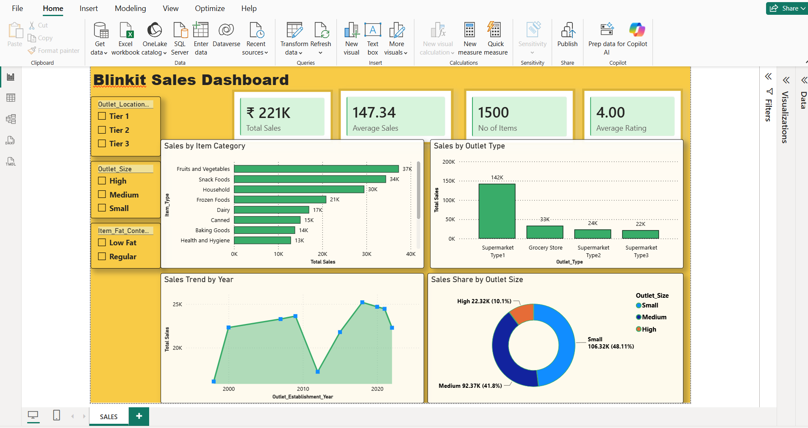

# 📊 Blinkit Sales & Outlet Performance Dashboard (Power BI)


-0C831F?style=for-the-badge)


An interactive Business Intelligence dashboard built in **Microsoft Power BI** to analyze Blinkit's retail sales, outlet performance, and customer rating trends across product categories, outlet sizes, and city tiers.



---

## 🎯 Executive Summary & KPIs

| Metric | Value | Business Context |
| :--- | :--- | :--- |
| **Total Sales** | **₹221.01K** (`₹221,013.24`) | Cumulative revenue across all 10 retail outlets |
| **Average Sales** | **₹147.34** | Mean revenue generated per SKU listing |
| **Total Items** | **1,500** | Distinct product records analyzed across 12 categories |
| **Average Rating** | **4.00 / 5.0** | Consistent customer satisfaction across outlet formats |

### Key Analytical Findings
* **Top-Performing Category:** **Fruits and Vegetables** generated the highest sales (**₹37.33K**), followed closely by **Snack Foods** and **Household** essentials.
* **Dominant Outlet Format:** **Supermarket Type1** drove **64.3%** of total revenue (**₹142.21K**), outperforming Grocery Stores and Supermarket Type2/Type3 formats.
* **Outlet Size Contribution:** **Small** outlets accounted for the largest revenue share (**48.11%** / `₹106.32K`), followed by **Medium** (**41.80%** / `₹92.37K`) and **High** (**10.10%** / `₹22.32K`).

---

## 🧹 Data Preparation & DAX Modeling

### 1. ETL & Cleaning in Power Query (`M`)
* **Standardized Categorical Labels:** Consolidated inconsistent `Item_Fat_Content` entries (`LF`, `low fat` → `Low Fat`; `reg` → `Regular`).
* **Missing Value Imputation:** Replaced null values in `Item_Weight` with the column mean to preserve record integrity.
* **Data Validation:** Enforced strict numeric/text column types and deduplicated records prior to loading.

### 2. Core DAX Measures
```dax
Total Sales = SUM(blinkit_sales_raw[Sales])
Average Sales = AVERAGE(blinkit_sales_raw[Sales])
No of Items = COUNTROWS(blinkit_sales_raw)
Average Rating = AVERAGE(blinkit_sales_raw[Rating])
```

---

## 🖥️ Dashboard Architecture

* **Dynamic Filter Slicers:** Interactive filtering by `Outlet_Location_Type` (Tier 1, Tier 2, Tier 3), `Outlet_Size` (Small, Medium, High), and `Item_Fat_Content` (Low Fat, Regular).
* **KPI Summary Cards:** Real-time tracking of Total Sales, Average Sales, Item Count, and Average Rating.
* **Category & Outlet Breakdowns:** Horizontal bar chart ranking all 12 item categories and column chart comparing outlet formats.
* **Trend & Share Analysis:** Historical sales trend by `Outlet_Establishment_Year` (1998–2022) and revenue distribution donut chart by `Outlet_Size`.

---

## 📂 Repository Structure

```text
Blinkit-Sales-Dashboard-PowerBI/
├── assets/
│   └── dashboard_preview.png        # High-resolution screenshot of the final report
├── data/
│   ├── blinkit_sales_raw.csv        # Original uncleaned dataset (1,500 records)
│   └── blinkit_sales_cleaned.csv    # Transformed dataset post Power Query steps
├── scripts/
│   ├── dax_measures.txt             # DAX formulas used for KPI cards and visuals
│   └── power_query_m_script.txt     # Power Query (M) transformation script
├── Blinkit_Sales_Dashboard.pbix     # Interactive Power BI Desktop report file
└── README.md
```

---

## 🚀 How to Explore Locally

1. Clone this repository or download `Blinkit_Sales_Dashboard.pbix`.
2. Open the file in **Power BI Desktop** (free on Windows).
3. Use the left-hand slicers to filter metrics dynamically across tiers, outlet sizes, and product types.

---

## 👤 Author

**Harrsha Sai Bathula**  
BS-MS in Computer Science (Data Science & Analytics) | Hyderabad, India  
[](https://www.linkedin.com/in/harrsha-sai-b8258334b)